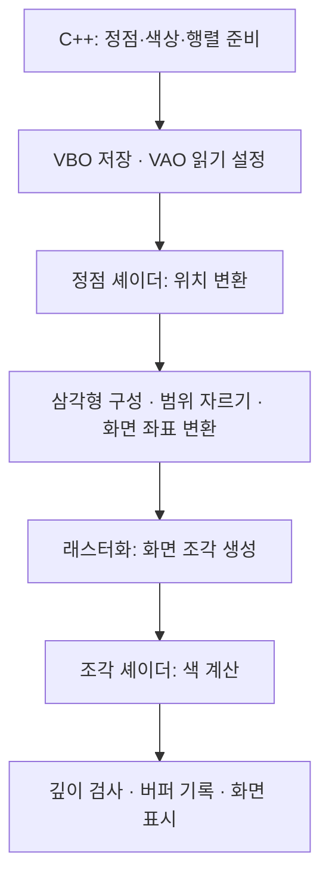

# 1-13 육면체와 사각뿔의 면 그리기 초보자를 위한 개발 순서와 코드 해설

이 문서는 [1-13.cpp](../1-4/1-4/1-13.cpp)를 처음 공부하는 사람을 위한 설명이다. [1-12 해설](1-12-shape-movement-matching-walkthrough.md)처럼 **만드는 순서**, **실제 코드 읽기**, **값을 바꾸는 연습**으로 구성했다.

**3부에는 이 프로그램을 이해하는 데 필요한 컴퓨터 그래픽스 기초를 덧붙였다.** 정점과 면, 좌표 변환, 행렬, 픽셀과 조각, 깊이 검사 등을 현재 코드와 연결해서 설명한다. 코드 설명 중 낯선 용어가 나오면 3부에서 찾아봐도 된다.

이번 프로그램은 도형을 움직이는 게임이 아니다. 꼭짓점과 면을 미리 준비하고, 키보드로 어떤 면을 그릴지 선택하는 프로그램이다.

처음 기억할 동작은 다음과 같다.

1. 화면 중앙에 기울어진 육면체와 좌표축이 나타난다.
2. 숫자를 누르면 해당 면 하나를 그린다.
3. `c`를 누르면 육면체의 서로 다른 면 두 개를 선택한다.
4. `t`를 누르면 사각뿔의 바닥과 옆면 하나를 선택한다.
5. 선택한 면들이 겹치면 가까운 면이 먼 면을 가린다.

**현재 코드는 새 명령마다 이전 선택을 지운다.** `1` 다음에 `2`를 누르면 앞면과 뒷면을 함께 그리는 것이 아니라, 뒷면 하나로 교체한다.

**과제의 기본 회전은 x축 30도, y축 30도지만 현재 소스의 `angleX`, `angleY`는 각각 50도다.** 과제 설명대로 30도를 사용하려면 두 변수의 값만 바꾼다. 아래 설명은 현재 코드를 기준으로 한다.

| 키 | 그리는 면 | 배열에서 사용하는 번호 |
| --- | --- | --- |
| `1` | 육면체 앞면 | `cubeVisible[0]` |
| `2` | 육면체 뒷면 | `cubeVisible[1]` |
| `3` | 육면체 왼쪽 면 | `cubeVisible[2]` |
| `4` | 육면체 오른쪽 면 | `cubeVisible[3]` |
| `5` | 육면체 윗면 | `cubeVisible[4]` |
| `6` | 육면체 아랫면 | `cubeVisible[5]` |
| `7` | 사각뿔 앞쪽 삼각형 | `pyramidVisible[0]` |
| `8` | 사각뿔 오른쪽 삼각형 | `pyramidVisible[1]` |
| `9` | 사각뿔 뒤쪽 삼각형 | `pyramidVisible[2]` |
| `0` | 사각뿔 왼쪽 삼각형 | `pyramidVisible[3]` |
| `c` | 육면체에서 랜덤한 두 면 | 서로 다른 두 칸을 `true`로 설정 |
| `t` | 사각뿔 바닥과 랜덤한 옆면 | `[4]`와 옆면 한 칸을 `true`로 설정 |
| `Esc` | 종료 | 창의 종료 상태를 설정 |

공부할 파일은 세 개다.

| 파일 | 역할 |
| --- | --- |
| [1-13.cpp](../1-4/1-4/1-13.cpp) | 창, 꼭짓점, 면 선택, 회전, 그리기 명령 |
| [1-13-vertex.glsl](../1-4/1-4/1-13-vertex.glsl) | 정점의 위치에 회전을 적용 |
| [1-13-fragment.glsl](../1-4/1-4/1-13-fragment.glsl) | 화면에 칠할 색을 출력 |

함수가 파일에 적힌 순서와 공부하기 좋은 순서는 다를 수 있다. 아래 코드 블록은 원본의 일부다. **각 블록을 따로 실행하는 완성 프로그램으로 생각하지 말고, 원본과 함께 읽는다.**

## 1 빈 창부터 띄운다

`main()`은 `default-Gl`의 기본 틀에서 시작한다.

1. `glfwInit()`으로 GLFW를 준비한다.
2. `glfwWindowHint()`로 OpenGL 3.3 Core Profile을 요청한다.
3. `glfwCreateWindow()`로 800 × 600 창을 만든다.
4. `glfwMakeContextCurrent()`로 이 창에 그림을 그리도록 설정한다.
5. `glewInit()`으로 OpenGL 함수를 사용할 준비를 한다.
6. 반복문에서 그림을 그리고 입력을 처리한다.
7. 종료할 때 사용한 자원과 창을 정리한다.

```cpp
#include <GL/glew.h>
#include <GL/glfw3.h>
```

GLFW는 창과 키보드를 담당한다. GLEW는 OpenGL 함수를 사용할 수 있도록 돕는다. `glew.h`를 `glfw3.h`보다 먼저 포함한다.

```cpp
GLFWwindow* window = glfwCreateWindow(
    800, 600, "1-13 Cube / Pyramid", nullptr, nullptr
);
```

`800`, `600`은 창의 가로와 세로 크기다. 뒤의 `nullptr` 두 개는 일반 창을 만들고 다른 창과 자원을 공유하지 않는다는 설정이다.

이 코드가 사용하는 Core Profile에서는 `glBegin()` 같은 옛 그리기 방식 대신 정점 데이터와 셰이더를 사용한다.

**확인:** 창이 열리는 것부터 확인한다. 초기화에 실패하면 콘솔에 표시된 메시지를 읽는다.

## 2 좌표 범위와 도형 크기를 구분한다

투영 행렬 없이 회전한 좌표를 `gl_Position`에 전달한다. 현재는 w가 1이므로 NDC에서도 같은 좌표를 사용한다. 화면에 보이는 범위는 각 축의 `-1 ~ 1`이다.

원점 `(0, 0, 0)`은 뷰포트 중앙에 대응한다. 도형 크기는 꼭짓점 배열로 정한다.

| 구분 | 현재 설정 | 바꾸는 위치 |
| --- | --- | --- |
| 좌표 범위 | `-1 ~ 1` | OpenGL의 NDC 범위 |

| 도형 크기 | 각 방향으로 `-0.4 ~ 0.4` | `cubePoints`, `pyramidPoints` |
| 창 크기 | 800 × 600 | `glfwCreateWindow()` |

이 세 가지는 서로 다른 설정이다. **과제의 좌표 범위를 유지하면서 도형을 작게 만들려면 꼭짓점 배열을 바꾼다.**

현재 육면체 한 변의 길이는 다음과 같다.

```text
오른쪽 끝 - 왼쪽 끝 = 0.4 - (-0.4) = 0.8
```

`0.4f`의 `f`는 `float`형 숫자라는 뜻이다. `float`는 소수점이 있는 값을 저장하는 자료형이다.

**확인:** 좌표 범위 `2.0`과 도형 한 변 길이 `0.8`을 구분해서 설명해 본다.

## 3 정점 하나의 위치와 색을 묶는다

정점은 도형을 그리는 데 사용하는 점이다. 이 프로그램에서는 정점 하나에 위치와 색을 함께 저장한다.

```cpp
struct Vertex
{
    float x, y, z;
    float red, green, blue;
};
```

`struct`는 관련된 값을 하나로 묶는 문법이다.

```text
정점 한 개 = x, y, z, red, green, blue
             위치 3개   색상 3개
```

예를 들어 다음 값은 빨간색 정점이다.

```cpp
{ -0.4f, -0.4f, 0.4f, 1.0f, 0.0f, 0.0f }
```

앞의 세 값은 위치다. 뒤의 세 값은 빨강, 초록, 파랑의 양이다. 색상 값은 `0 ~ 1`을 사용한다.

`cubePoints`에는 위치만 저장하고, `cubeColors`에는 색상만 저장한다. 나중에 두 정보를 합쳐 `Vertex` 배열을 만든다.

## 4 육면체의 꼭짓점 8개를 정한다

```cpp
float cubePoints[8][3] = {
    { -0.4f, -0.4f,  0.4f },  // 0
    {  0.4f, -0.4f,  0.4f },  // 1
    {  0.4f,  0.4f,  0.4f },  // 2
    { -0.4f,  0.4f,  0.4f },  // 3
    { -0.4f, -0.4f, -0.4f },  // 4
    {  0.4f, -0.4f, -0.4f },  // 5
    {  0.4f,  0.4f, -0.4f },  // 6
    { -0.4f,  0.4f, -0.4f }   // 7
};
```

`[8][3]`은 꼭짓점 8개에 좌표를 3개씩 저장한다는 뜻이다. 배열 번호는 0부터 시작한다.

```cpp
cubePoints[2][0]  // 2번 꼭짓점의 x좌표: 0.4
cubePoints[2][1]  // 2번 꼭짓점의 y좌표: 0.4
cubePoints[2][2]  // 2번 꼭짓점의 z좌표: 0.4
```

처음 네 점은 `z = 0.4`인 앞쪽 면에 있고, 뒤의 네 점은 `z = -0.4`인 뒤쪽 면에 있다. 여기서 앞쪽과 뒤쪽은 **회전하기 전 도형의 방향**이다.

앞쪽 네 점만 보면 다음과 같다.

```text
3 -------- 2
|          |
|          |
0 -------- 1
```

**확인:** 0번과 2번 꼭짓점을 읽어서 왼쪽 아래와 오른쪽 위인지 확인한다.

## 5 사각형 한 면을 삼각형 두 개로 나눈다

이 코드의 `GL_TRIANGLES`는 정점 세 개마다 삼각형 하나를 만든다. 사각형 한 면은 삼각형 두 개로 나눈다.

```cpp
int cubeFaces[6][6] = {
    { 0, 1, 2, 0, 2, 3 },  // 앞면
    { 5, 4, 7, 5, 7, 6 },  // 뒷면
    { 4, 0, 3, 4, 3, 7 },  // 왼쪽 면
    { 1, 5, 6, 1, 6, 2 },  // 오른쪽 면
    { 3, 2, 6, 3, 6, 7 },  // 윗면
    { 4, 5, 1, 4, 1, 0 }   // 아랫면
};
```

첫 번째 줄을 읽어 보자.

```text
0, 1, 2 : 첫 번째 삼각형
0, 2, 3 : 두 번째 삼각형
두 삼각형이 합쳐져 앞면 사각형 하나가 된다.
```

이 배열의 숫자는 좌표가 아니라 `cubePoints`의 꼭짓점 번호다.

```cpp
int point = cubeFaces[0][2];  // point는 2
// 따라서 cubePoints[2]의 위치를 사용한다.
```

도형의 실제 꼭짓점은 8개지만, 그리는 순서에 맞춰 정점을 반복해서 넣는다. 육면체 전체를 그릴 정점 수는 `6면 × 6정점 = 36`개다.

**확인:** 앞면의 여섯 번호를 세 개씩 나누어 읽는다.

## 6 면마다 색을 정한다

```cpp
float cubeColors[6][3] = {
    { 1.0f, 0.2f, 0.2f },  // 앞면: 빨강
    { 0.2f, 0.8f, 0.2f },  // 뒷면: 초록
    { 0.2f, 0.4f, 1.0f },  // 왼쪽: 파랑
    { 1.0f, 0.8f, 0.1f },  // 오른쪽: 노랑
    { 1.0f, 0.3f, 0.8f },  // 위쪽: 분홍
    { 0.1f, 0.8f, 0.9f }   // 아래쪽: 청록
};
```

`cubeFaces[0]`과 `cubeColors[0]`은 같은 앞면에 해당한다. 면 번호를 색상 배열의 번호로도 사용한다.

한 면의 정점 여섯 개에 모두 같은 색을 넣으므로 면 전체가 같은 색으로 보인다.

사각뿔의 색은 `pyramidColors`로 정한다. 앞쪽, 오른쪽, 뒤쪽, 왼쪽, 바닥 순서로 빨강, 초록, 파랑, 노랑, 분홍을 사용한다.

## 7 사각뿔의 꼭짓점과 면을 정한다

사각뿔에는 바닥 꼭짓점 네 개와 꼭대기 한 개가 있다.

```cpp
float pyramidPoints[5][3] = {
    { -0.4f, -0.4f,  0.4f },  // 0: 바닥
    {  0.4f, -0.4f,  0.4f },  // 1: 바닥
    {  0.4f, -0.4f, -0.4f },  // 2: 바닥
    { -0.4f, -0.4f, -0.4f },  // 3: 바닥
    {  0.0f,  0.4f,  0.0f }   // 4: 꼭대기
};
```

바닥의 y좌표는 전부 `-0.4`다. 꼭대기의 y좌표는 `0.4`다. 높이는 `0.4 - (-0.4) = 0.8`이다.

```cpp
int pyramidFaces[5][6] = {
    { 0, 1, 4, 0, 0, 0 },  // 앞쪽 삼각형
    { 1, 2, 4, 0, 0, 0 },  // 오른쪽 삼각형
    { 2, 3, 4, 0, 0, 0 },  // 뒤쪽 삼각형
    { 3, 0, 4, 0, 0, 0 },  // 왼쪽 삼각형
    { 3, 2, 1, 3, 1, 0 }   // 바닥 사각형
};
```

옆면은 삼각형이므로 앞의 번호 세 개만 사용한다. 뒤의 `0, 0, 0`은 배열 한 줄의 길이를 맞추기 위해 넣은 값이며, 옆면을 그릴 때 읽지 않는다.

바닥만 번호 여섯 개를 모두 사용해 삼각형 두 개를 만든다.

```text
옆면: 4면 × 3정점 = 12정점
바닥: 1면 × 6정점 =  6정점
합계:               18정점
```

**확인:** 사각뿔의 꼭대기 번호는 4다. 바닥 면의 번호도 4지만 서로 다른 배열의 번호다. `pyramidPoints[4]`는 점이고, `pyramidFaces[4]`는 면이다.

## 8 좌표축을 선 세 개로 만든다

좌표축은 도형의 위치와 방향을 보여 주는 선이다. 선 하나에는 끝점 두 개가 필요하므로 총 정점 여섯 개를 사용한다.

```cpp
Vertex axisVertices[6] = {
    { -1.0f, -0.3f, 0.0f, 1.0f, 0.0f, 0.0f },  // x축: 빨강
    {  1.0f,  0.3f, 0.0f, 1.0f, 0.0f, 0.0f },
    {  0.0f, -1.0f, 0.0f, 0.0f, 1.0f, 0.0f },  // y축: 초록
    {  0.0f,  1.0f, 0.0f, 0.0f, 1.0f, 0.0f },
    { -0.55f, 0.5f, 0.0f, 0.0f, 0.0f, 1.0f },  // z축 표시: 파랑
    {  0.55f,-0.5f, 0.0f, 0.0f, 0.0f, 1.0f }
};
```

| 두 끝점 | 바뀌는 좌표 | 색 |
| --- | --- | --- |
| 0번과 1번 | x: `-1 ~ 1`, y: `-0.3 ~ 0.3` | 빨강 |
| 2번과 3번 | y만 `-1 ~ 1` | 초록 |
| 4번과 5번 | x: `-0.55 ~ 0.55`, y: `0.5 ~ -0.5` | 파랑 |

세 축은 화면 중앙에서 만난다. PDF처럼 x축은 오른쪽 위, y축은 수직, z축 표시는 오른쪽 아래로 향한다. 화면 안내용 선이므로 모든 끝점의 z좌표는 0이다. 단위 행렬을 전달하므로 `angleX`, `angleY`를 바꿔도 축은 고정된다.

PDF 「지엘3 좌표계 변환 1」 29~30쪽처럼 초기화 때 `glEnable(GL_DEPTH_TEST)`를 한 번 호출하고, 매 프레임 `GL_DEPTH_BUFFER_BIT`를 지운다. 도형과 좌표축에 같은 깊이 검사를 적용하므로 좌표축도 더 가까운 면에 가려질 수 있다. 축의 위치와 방향은 화면에 고정된다.

## 9 GPU에 보낼 정점 60개를 만든다

GPU는 화면을 그리는 계산을 담당한다. GPU에 보내기 전에 위치와 색을 하나의 배열로 합친다.

```cpp
Vertex vertices[60];
int vertexCount = 0;
```

`vertexCount`는 지금까지 넣은 개수이면서, 다음 정점을 넣을 배열 번호다.

육면체를 넣는 실제 코드는 다음과 같다.

```cpp
for (int face = 0; face < 6; face++)
{
    for (int i = 0; i < 6; i++)
    {
        int point = cubeFaces[face][i];
        vertices[vertexCount] = {
            cubePoints[point][0], cubePoints[point][1], cubePoints[point][2],
            cubeColors[face][0], cubeColors[face][1], cubeColors[face][2]
        };
        vertexCount++;
    }
}
```

바깥 반복문은 면을 하나씩 고른다. 안쪽 반복문은 그 면을 그릴 정점 여섯 개를 넣는다.

첫 번째 반복을 따라가면 다음과 같다.

```text
face = 0, i = 0
cubeFaces[0][0]은 0이므로 point = 0
cubePoints[0]에서 위치를 가져온다.
cubeColors[0]에서 앞면의 색을 가져온다.
vertices[0]에 위치와 색을 저장한다.
vertexCount를 1로 늘린다.
```

육면체 다음에는 사각뿔, 마지막에는 좌표축을 넣는다.

| 데이터 | 개수 | `vertices`에서 사용하는 번호 |
| --- | --- | --- |
| 육면체 전체 | 36 | 0 ~ 35 |
| 사각뿔 옆면 네 개 | 12 | 36 ~ 47 |
| 사각뿔 바닥 | 6 | 48 ~ 53 |
| 좌표축 세 개 | 6 | 54 ~ 59 |
| 합계 | 60 | 0 ~ 59 |

사각뿔의 반복에서는 바닥에만 정점 여섯 개를 넣는다.

```cpp
int count = 3;
if (face == 4)
    count = 6;
```

**확인:** 왜 그리기 코드에 `36`, `48`, `54`가 나오는지 이 표로 설명해 본다.

## 10 VBO에 데이터를 넣고 VAO에 읽는 방법을 정한다

두 이름의 역할부터 기억한다.

| 이름 | 쉬운 뜻 |
| --- | --- |
| VBO | GPU에 정점 데이터를 저장하는 공간 |
| VAO | 그 데이터를 위치와 색으로 읽는 방법을 기록하는 객체 |

```cpp
GLuint vao, vbo;
glGenVertexArrays(1, &vao);
glGenBuffers(1, &vbo);
glBindVertexArray(vao);
glBindBuffer(GL_ARRAY_BUFFER, vbo);
glBufferData(GL_ARRAY_BUFFER, sizeof(vertices), vertices, GL_STATIC_DRAW);
```

`GLuint`는 OpenGL이 만든 객체의 번호를 저장하는 자료형이다. `vao`, `vbo`는 실제 정점 배열이 아니라 그 객체를 구분하는 번호다.

`glGen...()`은 객체를 만든다. `glBind...()`는 다음 작업에 사용할 객체를 선택한다. `glBufferData()`는 정점 배열을 GPU에 복사한다.

`GL_STATIC_DRAW`는 데이터를 자주 바꾸지 않을 것이라는 사용 방식의 힌트다. 이 프로그램은 시작할 때 정점을 한 번 보내고, 이후에는 어떤 면을 그릴지만 바꾼다.

```cpp
glVertexAttribPointer(0, 3, GL_FLOAT, GL_FALSE, sizeof(Vertex), nullptr);
glEnableVertexAttribArray(0);
glVertexAttribPointer(1, 3, GL_FLOAT, GL_FALSE, sizeof(Vertex), (void*)(3 * sizeof(float)));
glEnableVertexAttribArray(1);
```

| 설정 | 뜻 |
| --- | --- |
| 첫 번째 인자 `0` | 위치를 0번 속성으로 보낸다. |
| 첫 번째 인자 `1` | 색을 1번 속성으로 보낸다. |
| 두 번째 인자 `3` | 위치도 색도 실수 세 개씩 읽는다. |
| `GL_FLOAT` | 각 값을 `float`로 읽는다. |
| `GL_FALSE` | 정수 값을 자동으로 0 ~ 1 범위로 바꾸는 정규화를 요청하지 않는다. 현재 데이터는 실수다. |
| `sizeof(Vertex)` | 다음 정점까지 건너갈 바이트 수다. |
| 위치의 `nullptr` | 정점의 처음부터 위치를 읽는다. |
| 색의 `3 * sizeof(float)` | 위치 세 값을 건너뛴 뒤 색을 읽는다. |

여기서 색의 마지막 인자는 일반적인 메모리 주소가 아니라 **VBO 안에서 시작할 위치**를 뜻한다. `(void*)`는 OpenGL 함수가 요구하는 인자 형태에 맞춘 표현이다.

**확인:** 위치는 세 값인데 색의 시작 위치를 `2 * sizeof(float)`로 바꾸면 z좌표부터 색으로 읽게 된다. 현재는 반드시 3개를 건너뛰어야 한다.

## 11 셰이더 파일을 읽고 준비한다

`ReadShaderFile()`은 GLSL 파일을 문자열로 읽는다.

```cpp
std::string vertexSource = ReadShaderFile("1-13-vertex.glsl");
std::string fragmentSource = ReadShaderFile("1-13-fragment.glsl");
```

`std::string`은 글자를 저장하는 자료형이다. 읽은 셰이더 코드 전체를 여기에 담는다.

파일을 찾는 순서는 다음과 같다.

1. 프로그램의 현재 작업 폴더에서 찾는다.
2. 없으면 `1-13.cpp`가 있는 폴더에서 찾는다.
3. 두 곳 모두 실패하면 오류를 출력하고 빈 문자열을 돌려준다.

**현재 작업 폴더가 항상 실행 파일의 폴더인 것은 아니다.** 실행 방법에 따라 달라질 수 있으므로 소스 폴더에서도 찾도록 되어 있다.

```cpp
std::filesystem::path sourceFolder = std::filesystem::path(__FILE__).parent_path();
```

`__FILE__`은 현재 소스 파일의 경로를 나타낸다. 프로젝트의 `/FC` 옵션으로 전체 경로를 기록한다. `parent_path()`는 파일 이름을 제외한 폴더 경로를 가져온다.

파일은 한 줄씩 읽는다.

```cpp
std::string source;
std::string line;
while (std::getline(file, line))
    source += line + "\n";
```

`std::getline()`은 한 줄을 읽는다. `+=`는 기존 문자열 뒤에 글자를 붙인다. 줄바꿈 `\n`을 다시 붙여 원래 셰이더 코드의 줄을 유지한다.

`CompileShader()`는 읽은 코드를 GPU에서 사용할 수 있도록 컴파일한다. `source.c_str()`은 C++ 문자열을 OpenGL 함수가 받는 문자열 형태로 전달한다.

그 다음 `main()`에서 두 셰이더를 연결한다.

```cpp
GLuint shaderProgram = glCreateProgram();
glAttachShader(shaderProgram, vertexShader);
glAttachShader(shaderProgram, fragmentShader);
glLinkProgram(shaderProgram);
```

정점 셰이더와 조각 셰이더를 하나의 셰이더 프로그램으로 묶는 과정이다. 파일 읽기, 컴파일, 연결 중 하나라도 실패하면 콘솔에 오류를 출력하고 종료한다.

빌드하면 프로젝트 설정이 전용 셰이더 두 개를 실행 파일이 만들어진 폴더로 복사한다. 기존의 `vertex.glsl`, `fragment.glsl`은 수정하지 않고 이전 실습에서 계속 사용한다.

## 12 정점 셰이더와 조각 셰이더를 읽는다

`1-13-vertex.glsl`의 입력은 C++의 VAO 설정과 일치한다.

```glsl
layout (location = 0) in vec3 position;
layout (location = 1) in vec3 color;
```

`vec3`는 값 세 개를 묶는 자료형이다. 0번 입력에는 x, y, z가 들어오고, 1번 입력에는 빨강, 초록, 파랑이 들어온다.

```glsl
uniform mat4 transform;
out vec3 vertexColor;

void main()
{
    gl_Position = transform * vec4(position, 1.0);
    vertexColor = color;
}
```

| 코드 | 뜻 |
| --- | --- |
| `uniform mat4 transform` | C++에서 보낸 4 × 4 변환 행렬을 받는다. |
| `vec4(position, 1.0)` | x, y, z 뒤에 1을 붙여 행렬 계산에 사용하는 점으로 만든다. |
| `transform * ...` | 점에 회전을 적용한다. |
| `gl_Position` | OpenGL에 최종 클립 좌표를 전달한다. 이후 화면 좌표로 변환된다. |
| `vertexColor = color` | 받은 색을 다음 셰이더로 보낸다. |

`vec4`는 값 네 개를 묶는다. 마지막 값 1은 이 좌표가 위치를 가진 점임을 나타낸다. 자세한 동차 좌표 이론을 몰라도 지금은 **4 × 4 행렬을 점에 적용하려고 1을 붙인다**고 이해하면 된다.

`1-13-fragment.glsl`은 색을 출력한다.

```glsl
in vec3 vertexColor;
out vec4 finalColor;

void main()
{
    finalColor = vec4(vertexColor, 1.0);
}
```

정점 셰이더의 `out vertexColor`가 조각 셰이더의 `in vertexColor`로 이어진다. 실제 조각 색은 정점 색을 사이에서 계산해 받지만, 한 면의 모든 정점이 같은 색이므로 그 면은 같은 색으로 칠해진다.

조각 셰이더는 화면에 칠할 부분의 색을 정한다. 마지막 `1.0`은 알파 값이다. 현재는 불투명한 색을 출력한다.

**확인:** C++의 속성 번호 0, 1과 셰이더의 `location = 0`, `location = 1`을 짝지어 본다.

## 13 어떤 도형과 면을 그릴지 저장한다

```cpp
int objectType = 0;
bool cubeVisible[6] = { true, true, true, true, true, true };
bool pyramidVisible[5] = { false, false, false, false, false };
```

`objectType`이 0이면 육면체, 1이면 사각뿔을 그린다.

`bool`은 `true` 또는 `false`를 저장하는 자료형이다. 여기서는 `true`면 해당 면을 그릴 대상으로 선택하고, `false`면 그리지 않는다.

처음에는 육면체의 모든 면이 선택되어 있다. 사각뿔은 선택되어 있지 않다.

`ClearFaces()`는 두 도형의 모든 면 선택을 지운다.

```cpp
void ClearFaces()
{
    for (int i = 0; i < 6; i++)
        cubeVisible[i] = false;
    for (int i = 0; i < 5; i++)
        pyramidVisible[i] = false;
}
```

이 함수는 꼭짓점 데이터를 삭제하지 않는다. 그릴 면을 정하는 표시만 `false`로 바꾼다.

**확인:** `cubeVisible[2] = true`는 2번 꼭짓점이 아니라 육면체의 왼쪽 면을 선택한다.

## 14 숫자 키를 면 번호로 바꾼다

키보드 함수를 GLFW에 등록한다.

```cpp
glfwSetKeyCallback(window, KeyCallback);
```

콜백은 특정 일이 생겼을 때 호출되는 함수다. GLFW가 키 입력을 처리할 때 `KeyCallback()`을 호출한다.

```cpp
if (action != GLFW_PRESS)
    return;
```

`!=`는 같지 않다는 뜻이다. 키를 처음 누른 순간만 처리하고, 키를 놓거나 누르고 있어서 발생한 반복 입력은 처리하지 않는다. `return`은 현재 함수의 실행을 끝낸다.

육면체의 면 선택은 다음과 같다.

```cpp
else if (key >= GLFW_KEY_1 && key <= GLFW_KEY_6)
{
    ClearFaces();
    objectType = 0;
    cubeVisible[key - GLFW_KEY_1] = true;
}
```

`&&`는 두 조건이 모두 맞아야 한다는 뜻이다. 키가 1 이상이고 6 이하일 때 실행한다.

| 누른 키 | `key - GLFW_KEY_1` | 선택 결과 |
| --- | --- | --- |
| `1` | 0 | 앞면 |
| `2` | 1 | 뒷면 |
| `6` | 5 | 아랫면 |

숫자 키는 1부터 시작하지만 배열은 0부터 시작하므로 번호를 맞추는 계산이다.

사각뿔은 `7`, `8`, `9`에서 `GLFW_KEY_7`을 빼서 0, 1, 2번 면을 선택한다. `0`키는 따로 처리해 3번 면을 선택한다.

**확인:** `1`, `2`, `7`, `0`을 차례로 누르면 앞면, 뒷면, 사각뿔 앞면, 사각뿔 왼쪽 면으로 교체되는지 확인한다.

## 15 랜덤한 면을 고른다

`c`는 서로 다른 육면체 면 두 개를 선택한다.

```cpp
ClearFaces();
objectType = 0;
int first = std::rand() % 6;
int second = std::rand() % 6;
while (first == second)
    second = std::rand() % 6;
cubeVisible[first] = true;
cubeVisible[second] = true;
```

`std::rand()`는 난수 값을 만든다. `%`는 나머지를 구한다. 어떤 음이 아닌 정수를 6으로 나눈 나머지는 0부터 5까지이므로 면 배열의 번호로 사용할 수 있다.

`==`는 두 값이 같은지 검사한다. 같은 면이 두 번 나오면 `while`에서 두 번째 번호를 다시 뽑는다.

```text
first = 2, second = 2: 같은 면이므로 second를 다시 뽑는다.
first = 2, second = 5: 서로 다르므로 2번과 5번을 선택한다.
```

`t`는 사각뿔의 옆면 번호 0 ~ 3 중 하나와 바닥 번호 4를 선택한다.

```cpp
ClearFaces();
objectType = 1;
int side = std::rand() % 4;
pyramidVisible[side] = true;
pyramidVisible[4] = true;
```

프로그램 시작 때 한 번 실행하는 다음 코드는 난수 생성의 시작값을 현재 시간으로 정한다.

```cpp
std::srand((unsigned int)std::time(nullptr));
```

`c`나 `t`를 다시 누를 때 같은 조합이 나올 수도 있다. 이전 선택과 다른 결과가 반드시 나온다는 뜻은 아니다. `c`에서 보장하는 것은 **한 번 선택한 두 면이 서로 다르다**는 점이다.

또한 두 면이 선택되어 있어도, 한 면이 다른 면 뒤에 완전히 가려지면 화면에서는 하나처럼 보일 수 있다.

## 16 회전 행렬을 만든다

현재 기울기는 다음 두 변수로 정한다.

```cpp
float angleX = 50.0f;
float angleY = 50.0f;
```

실제 회전 코드는 메인 루프에 있다.

```cpp
glm::mat4 model = glm::mat4(1.0f);
model = glm::rotate(model, glm::radians(angleY), glm::vec3(0.0f, 1.0f, 0.0f));
model = glm::rotate(model, glm::radians(angleX), glm::vec3(1.0f, 0.0f, 0.0f));
```

행렬은 점의 위치를 바꾸는 계산을 묶어 둔 표라고 생각하면 된다. 처음부터 모든 칸의 계산을 외울 필요는 없다.

| 코드 | 쉬운 뜻 |
| --- | --- |
| `glm::mat4(1.0f)` | 아무것도 바꾸지 않는 단위 행렬로 시작한다. |
| `glm::radians(angleY)` | 도 단위의 각도를 함수에서 사용하는 라디안 단위로 바꾼다. |
| `glm::vec3(0, 1, 0)` | y축을 중심으로 회전한다. |
| `glm::vec3(1, 0, 0)` | x축을 중심으로 회전한다. |

**코드에서 y 회전을 먼저 적었지만 점에는 x 회전부터 적용된다.** GLM이 기존 행렬의 오른쪽에 새 회전 행렬을 곱하고, 점에는 오른쪽 행렬부터 적용하기 때문이다.

```text
현재 model = y회전 × x회전
점에 적용되는 순서 = x회전 후 y회전
```

매 프레임 단위 행렬부터 다시 만들고 같은 각도를 적용한다. 따라서 도형이 계속 빙글빙글 도는 애니메이션은 아니다.

**확인:** 두 각도를 30으로 바꾸면 과제에 적힌 기본 각도를 사용한다. 두 값을 0으로 바꾸면 앞면과 뒷면이 정면에서 겹친다. 화면 안내용 좌표축의 모양은 그대로 유지된다.

## 17 회전 행렬을 셰이더에 보낸다

```cpp
glUseProgram(shaderProgram);
GLint transformLocation = glGetUniformLocation(shaderProgram, "transform");
```

`glUseProgram()`은 사용할 셰이더 프로그램을 선택한다. `glGetUniformLocation()`은 그 프로그램 안의 `transform` 변수를 찾는다.

메인 루프에서 보낼 값을 만든다.

```cpp
glUniformMatrix4fv(transformLocation, 1, GL_FALSE, glm::value_ptr(model));
```

`model`에 만든 회전 행렬을 그대로 셰이더에 전달한다. 별도의 투영 행렬은 사용하지 않는다.

| 인자 | 뜻 |
| --- | --- |
| `transformLocation` | 값을 받을 셰이더 변수의 위치 |
| `1` | 행렬 한 개를 전달 |
| `GL_FALSE` | 행과 열을 뒤집는 전치 없이 전달 |
| `glm::value_ptr(model)` | 행렬의 데이터 주소를 전달 |

전체 연결은 다음과 같다.

```text
C++에서 회전 행렬을 계산한다.
glUniformMatrix4fv()로 transform에 보낸다.
정점 셰이더가 transform × 점을 계산한다.
OpenGL이 계산된 위치를 화면에 표시한다.
```

**확인:** C++의 `"transform"`과 GLSL의 `uniform mat4 transform;`은 같은 이름이어야 한다.

## 18 깊이 검사로 은면을 제거한다

은면 제거는 앞에 있는 면이 뒤에 있는 면을 가리도록 처리하는 것이다.

```cpp
glfwWindowHint(GLFW_DEPTH_BITS, 24);
```

창을 만들기 전에 깊이 정보를 저장할 버퍼를 24비트로 요청한다.

```cpp
glEnable(GL_DEPTH_TEST);
```

OpenGL의 깊이 검사를 켠다. 그릴 부분의 깊이를 비교해서 가까운 부분이 보이도록 한다.

매 프레임 색과 깊이를 함께 지운다.

```cpp
glClear(GL_COLOR_BUFFER_BIT | GL_DEPTH_BUFFER_BIT);
```

여기서 `|`는 두 종류의 버퍼를 함께 지우도록 지정하는 비트 연산자다. 조건 검사에서 사용하는 `||`와 다르다.

깊이 버퍼를 매번 지워야 이전 프레임의 깊이 정보가 이번 화면을 방해하지 않는다.

현재는 뒷면 컬링을 켜지 않는다. 컬링은 뒤를 향한 면의 그리기 자체를 생략하는 기능이다. 이번 과제는 뒷면 하나만 따로 선택해도 그려야 하므로, **면을 생략하는 컬링 대신 겹친 부분을 가리는 깊이 검사**를 사용한다.

**확인:** 처음의 전체 육면체에서 뒤쪽 면이 앞쪽 면 위에 덮여 그려지지 않는지 확인한다. 뒷면 하나만 선택하면 다른 육면체 면이 그려지지 않으므로 뒷면도 볼 수 있다.

## 19 선택한 면만 그린다

육면체를 그리는 부분은 다음과 같다.

```cpp
for (int face = 0; face < 6; face++)
{
    if (cubeVisible[face])
        glDrawArrays(GL_TRIANGLES, face * 6, 6);
}
```

`glDrawArrays()`의 세 인자는 **그리는 방식, 시작 정점 번호, 사용할 정점 개수**다.

```cpp
glDrawArrays(GL_TRIANGLES, face * 6, 6);
```

면 하나에 정점 여섯 개가 있으므로 `face * 6`으로 시작 위치를 구한다.

| 면 번호 | 시작 정점 | 사용할 정점 번호 |
| --- | --- | --- |
| 0: 앞면 | 0 | 0 ~ 5 |
| 1: 뒷면 | 6 | 6 ~ 11 |
| 2: 왼쪽 면 | 12 | 12 ~ 17 |
| 5: 아랫면 | 30 | 30 ~ 35 |

사각뿔 옆면은 육면체 정점 36개 뒤에 있고, 면마다 정점 세 개를 사용한다.

```cpp
glDrawArrays(GL_TRIANGLES, 36 + face * 3, 3);
```

사각뿔 바닥은 48번부터 여섯 개다.

```cpp
if (pyramidVisible[4])
    glDrawArrays(GL_TRIANGLES, 48, 6);
```

좌표축은 마지막 정점 여섯 개를 선으로 그린다.

```cpp
glm::mat4 identity = glm::mat4(1.0f);
glUniformMatrix4fv(transformLocation, 1, GL_FALSE, glm::value_ptr(identity));
glDrawArrays(GL_LINES, 54, 6);
```

`GL_LINES`는 정점 두 개마다 선 하나를 만든다. 정점 여섯 개로 선 세 개를 그린다.

**확인:** `glDrawArrays(GL_TRIANGLES, 48, 6)`에서 6은 면 여섯 개가 아니라 정점 여섯 개다.

## 20 화면 비율과 전체 반복 순서를 연결한다

창은 800 × 600이지만, 도형을 그리는 영역은 중앙의 정사각형으로 정한다.

```cpp
void FramebufferSizeCallback(GLFWwindow* window, int width, int height)
{
    int size = width;
    if (height < width)
        size = height;
    glViewport((width - size) / 2, (height - size) / 2, size, size);
}
```

가로와 세로 중 작은 값을 사용해 정사각형을 만든다. 남는 공간의 절반만큼 이동해 중앙에 놓는다.

```text
width = 800, height = 600
size = 600
왼쪽 여백 = (800 - 600) / 2 = 100
아래쪽 여백 = (600 - 600) / 2 = 0
실제 그리기 영역 = 600 × 600
```

`glViewport()`는 좌표를 그릴 화면 영역을 정한다. 좌표 범위 자체를 바꾸는 함수는 아니다. 이렇게 하면 직사각형 창에서도 육면체가 가로로 늘어나지 않는다.

`glfwGetFramebufferSize()`는 실제 그림을 그릴 영역의 픽셀 크기를 가져온다. `glfwSetFramebufferSizeCallback()`은 그 크기가 바뀔 때 이 함수를 호출하도록 등록한다.

메인 루프는 다음 순서로 실행한다.

1. 배경과 깊이 버퍼를 지운다.
2. 회전 행렬을 만든다.
3. 행렬을 셰이더에 보낸다.
4. 선택한 도형의 면을 그린다.
5. 좌표축을 그린다.
6. `glfwSwapBuffers()`로 완성된 화면을 보여 준다.
7. `glfwPollEvents()`로 키보드와 창 크기 변경을 처리한다.

키 입력으로 바뀐 면 선택은 다음 반복에서 그려진다. 이 프로그램은 정점 배열을 매 프레임 다시 만들지 않는다. 이미 저장된 정점 중 사용할 부분만 고른다.

종료하면 `glDeleteBuffers()`, `glDeleteVertexArrays()`, `glDeleteProgram()`으로 GPU 자원을 정리하고, 창과 GLFW를 종료한다.

## 전체 흐름 4번 키를 누르는 예

처음에는 `objectType = 0`이고 육면체의 모든 면이 선택되어 있다.

1. 사용자가 `4`를 누른다.
2. `glfwPollEvents()`에서 `KeyCallback()`이 호출된다.
3. `ClearFaces()`로 이전 선택을 전부 `false`로 바꾼다.
4. `objectType = 0`으로 육면체를 선택한다.
5. `key - GLFW_KEY_1`의 결과는 3이다.
6. `cubeVisible[3] = true`로 오른쪽 면만 선택한다.
7. 다음 프레임에 `face = 3`에서만 그리기 명령이 실행된다.

```cpp
glDrawArrays(GL_TRIANGLES, 3 * 6, 6);
```

정점 18번부터 23번까지 사용해서 오른쪽 면의 삼각형 두 개를 그린다. 색은 `cubeColors[3]`의 노란색이다. 마지막에 좌표축도 그린다.

# 2부 핵심 코드를 바꾸며 이해하기

아래 예제는 연습용 변경 방법이다. 한 번에 하나씩 바꾸고 저장한 뒤 다시 빌드하고 실행한다. 원본 코드를 먼저 보관해 두면 되돌리기 쉽다.

## 21 육면체 전체 크기를 바꾼다

`cubePoints` 안의 `-0.4f`, `0.4f`를 각각 `-0.3f`, `0.3f`로 바꾼다.

```cpp
float cubePoints[8][3] = {
    { -0.3f, -0.3f,  0.3f },
    {  0.3f, -0.3f,  0.3f },
    {  0.3f,  0.3f,  0.3f },
    { -0.3f,  0.3f,  0.3f },
    { -0.3f, -0.3f, -0.3f },
    {  0.3f, -0.3f, -0.3f },
    {  0.3f,  0.3f, -0.3f },
    { -0.3f,  0.3f, -0.3f }
};
```

한 변 길이는 `0.3 - (-0.3) = 0.6`이 된다. 부호는 그대로 유지해야 한다. 음수를 양수로 바꾸면 점이 반대쪽으로 이동해 도형이 변형된다.

| 원하는 한 변 길이 | 꼭짓점에 사용할 값 |
| --- | --- |
| 0.4 | `-0.2`, `0.2` |
| 0.6 | `-0.3`, `0.3` |
| 0.8 | `-0.4`, `0.4` |
| 1.0 | `-0.5`, `0.5` |

원점을 중심으로 만들 때는 원하는 길이의 절반을 양수와 음수로 사용한다. 너무 키우면 회전한 꼭짓점이 화면 범위를 벗어나 잘릴 수 있다.

**연습:** 한 변을 0.6으로 바꾸고 좌표축 길이는 그대로인지 확인한다. 뷰포트 설정은 수정하지 않는다.

## 22 육면체의 가로 높이 깊이를 따로 바꾼다

꼭짓점의 각 열이 담당하는 크기는 다음과 같다.

| 열 | 방향 | 예시 범위 | 길이 |
| --- | --- | --- | --- |
| 첫 번째: x | 가로 | `-0.3 ~ 0.3` | 0.6 |
| 두 번째: y | 높이 | `-0.5 ~ 0.5` | 1.0 |
| 세 번째: z | 깊이 | `-0.2 ~ 0.2` | 0.4 |

이 크기의 직육면체를 만들려면 여덟 점의 각 열을 같은 기준으로 바꾼다.

```cpp
float cubePoints[8][3] = {
    { -0.3f, -0.5f,  0.2f },
    {  0.3f, -0.5f,  0.2f },
    {  0.3f,  0.5f,  0.2f },
    { -0.3f,  0.5f,  0.2f },
    { -0.3f, -0.5f, -0.2f },
    {  0.3f, -0.5f, -0.2f },
    {  0.3f,  0.5f, -0.2f },
    { -0.3f,  0.5f, -0.2f }
};
```

숫자는 회전하기 전 도형의 크기다. 기울어진 화면에서 보이는 가로 길이는 회전 때문에 이 숫자와 다를 수 있다.

## 23 사각뿔의 바닥 크기와 높이를 바꾼다

바닥 크기는 처음 네 점의 x와 z로 정한다. 높이는 바닥의 y와 꼭대기의 y 차이로 정한다.

다음은 바닥 한 변 0.4, 높이 1.0인 사각뿔이다.

```cpp
float pyramidPoints[5][3] = {
    { -0.2f, -0.5f,  0.2f },
    {  0.2f, -0.5f,  0.2f },
    {  0.2f, -0.5f, -0.2f },
    { -0.2f, -0.5f, -0.2f },
    {  0.0f,  0.5f,  0.0f }
};
```

```text
바닥 한 변 = 0.2 - (-0.2) = 0.4
높이 = 0.5 - (-0.5) = 1.0
```

꼭대기의 x와 z를 0으로 유지하면 바닥 중앙 위에 놓인다. 꼭대기의 x만 바꾸면 크기를 균등하게 바꾸는 대신 꼭대기가 옆으로 치우친 사각뿔이 된다.

**연습:** 바닥의 y좌표를 모두 같게 유지하면서 바닥 넓이와 높이를 각각 바꿔 본다.

## 24 색상과 기울기를 바꾼다

육면체 앞면을 순수한 빨간색으로 바꾸려면 `cubeColors`의 첫 번째 줄을 다음으로 바꾼다.

```cpp
{ 1.0f, 0.0f, 0.0f }
```

색을 바꾸려면 색상 배열을 수정한다. 꼭짓점 위치 배열은 수정하지 않는다.

| 색 | 빨강, 초록, 파랑 |
| --- | --- |
| 빨강 | `{ 1.0f, 0.0f, 0.0f }` |
| 초록 | `{ 0.0f, 1.0f, 0.0f }` |
| 파랑 | `{ 0.0f, 0.0f, 1.0f }` |
| 노랑 | `{ 1.0f, 1.0f, 0.0f }` |
| 흰색 | `{ 1.0f, 1.0f, 1.0f }` |

흰색 면은 현재 흰 배경과 구분하기 어렵다. 연습할 때는 빨강이나 파랑처럼 배경과 다른 색을 사용한다.

회전 각도를 바꾸려면 다음 두 값만 수정한다.

```cpp
float angleX = 30.0f;
float angleY = 30.0f;
```

이는 과제에 적힌 기본 각도를 사용하는 예다. 현재 원본은 각각 50도다. 두 값이 달라도 되며, 음수 각도는 반대 방향으로 회전한다.

**연습:** x만 30, y만 50으로 설정하고 두 축의 회전 효과를 비교한다. 도형의 각도를 바꿔도 화면 좌표축은 고정되어 있는지 확인한다.

## 25 변경하면 안 되는 연결을 구분한다

숫자가 같아 보여도 역할이 다르면 따로 생각해야 한다.

| 변경할 내용 | 수정할 부분 | 함께 바꿀 필요가 없는 부분 |
| --- | --- | --- |
| 도형 크기 | `cubePoints`, `pyramidPoints` | 면 번호, 색상, 좌표 범위 |
| 면 색상 | `cubeColors`, `pyramidColors` | 꼭짓점 위치 |
| 회전 각도 | `angleX`, `angleY` | 셰이더 파일 |
| 창 크기 | `glfwCreateWindow()`의 800, 600 | 도형 좌표, 뷰포트 설정 |

반대로 다음 연결은 양쪽을 맞춰야 한다.

1. C++의 위치 속성 0번과 GLSL의 `location = 0`.
2. C++의 색 속성 1번과 GLSL의 `location = 1`.
3. C++의 위치 값 세 개와 GLSL의 `vec3 position`.
4. C++의 `"transform"`과 GLSL의 `uniform mat4 transform`.
5. 정점을 배열에 넣는 순서와 `glDrawArrays()`의 시작 번호.

면 수나 정점 수를 바꾸면 60개 배열 크기와 36, 48, 54 시작 번호도 다시 계산해야 한다. 단순히 크기나 색을 바꾸는 연습에서는 이 숫자들을 유지한다.

## 26 실행하며 직접 점검한다

먼저 Visual Studio에서 **x64 구성으로 빌드하고 실행**한다. 현재 프로젝트의 실행 소스는 `1-13.cpp`다.

- [ ] 처음 실행하면 육면체와 좌표축이 보인다.
- [ ] `1 ~ 6`을 각각 누르면 육면체의 해당 면 하나로 교체된다.
- [ ] `7`, `8`, `9`, `0`을 각각 누르면 사각뿔의 해당 삼각형 면으로 교체된다.
- [ ] `c`를 여러 번 누르면 육면체 면 두 개를 선택한다. 서로 가려지면 한 면처럼 보일 수 있다.
- [ ] `t`를 여러 번 누르면 사각뿔의 바닥과 옆면을 선택한다.
- [ ] 키를 누르고 있어도 랜덤 선택이 계속 바뀌지 않는다.
- [ ] 창을 가로로 늘려도 도형의 비율이 유지된다.
- [ ] 회전 각도를 바꾸고 다시 빌드하면 기울기가 바뀐다.
- [ ] 꼭짓점 크기를 바꾸고 다시 빌드하면 도형 크기만 바뀐다.
- [ ] `Esc`를 누르면 종료한다.

GLSL 파일의 내용을 바꾼 경우에도 다시 빌드하면 실행 폴더의 복사본에 반영된다. 이미 실행 중인 프로그램은 셰이더 파일을 자동으로 다시 읽지 않으므로 종료 후 재실행한다.

| 증상 | 먼저 확인할 부분 |
| --- | --- |
| 셰이더 파일을 열 수 없다는 오류 | 전용 GLSL 파일 이름과 위치, 빌드 후 복사본 |
| 셰이더 컴파일 실패 | GLSL의 문법과 콘솔 오류 메시지 |
| 면이 이상한 색으로 보임 | 색상 배열, VAO의 색상 시작 위치 |
| 삼각형이 엉뚱하게 연결됨 | 면 배열의 꼭짓점 번호 |
| 도형 일부가 화면 밖에서 잘림 | 꼭짓점 크기와 회전 후 위치 |
| 숫자를 눌렀는데 다른 면이 남아 있음 | `ClearFaces()`와 선택 배열 |

이 문서의 점검표는 직접 확인할 항목이다. 자동 검사 기능이 `1-13.cpp`에 별도로 들어 있다는 뜻은 아니다.

## 함수와 배열이 헷갈릴 때 찾아볼 표

| 이름 | 역할 |
| --- | --- |
| `cubePoints` | 육면체 꼭짓점 8개의 위치 |
| `cubeFaces` | 육면체 면을 만들 꼭짓점 번호 |
| `cubeColors` | 육면체 각 면의 색 |
| `pyramidPoints` | 사각뿔 꼭짓점 5개의 위치 |
| `pyramidFaces` | 사각뿔 면을 만들 꼭짓점 번호 |
| `pyramidColors` | 사각뿔 각 면의 색 |
| `axisVertices` | 좌표축 끝점의 위치와 색 |
| `objectType` | 그릴 도형의 종류 |
| `cubeVisible`, `pyramidVisible` | 그릴 대상으로 선택한 면 |
| `ReadShaderFile()` | GLSL 파일을 문자열로 읽음 |
| `CompileShader()` | GLSL 코드를 컴파일 |
| `ClearFaces()` | 이전 면 선택을 모두 지움 |
| `KeyCallback()` | 키에 따라 도형과 면을 선택 |
| `FramebufferSizeCallback()` | 중앙의 정사각형 그리기 영역을 설정 |
| `main()` | 초기화, 데이터 준비, 반복 그리기, 종료 |
| `glm::rotate()` | 회전 행렬을 적용 |
| `glUniformMatrix4fv()` | 행렬을 셰이더에 전달 |
| `glDrawArrays()` | 지정한 정점 구간을 삼각형이나 선으로 그림 |

처음 공부할 때는 **점의 위치를 정하고, 점을 연결해 면을 만들고, 선택한 면만 그린다**는 순서부터 이해한다. 그 다음 VAO/VBO와 셰이더가 이 정보를 화면에 전달하는 과정을 읽는다.

# 3부 1-13에 필요한 컴퓨터 그래픽스 기초

여기서는 이번 프로그램을 이해하는 데 필요한 개념부터 설명한다. 새로운 그래픽 기능을 구현하는 코드가 아니라, 앞에서 읽은 코드가 왜 그렇게 동작하는지 이해하는 내용이다.

## 27 CPU와 GPU는 어떤 일을 나누어 할까

CPU는 일반적인 프로그램 계산을 담당하고, GPU는 많은 정점과 화면 조각을 처리하는 데 사용된다.

현재 코드의 일을 나누면 다음과 같다.

| CPU 쪽 C++ 코드 | GPU 쪽 셰이더와 그리기 처리 |
| --- | --- |
| 키보드 입력에 따라 면을 선택한다. | 그리기 명령에 포함된 정점들을 처리한다. |
| 꼭짓점 위치와 면 색을 준비한다. | 정점 셰이더에서 위치를 변환한다. |
| 회전 행렬을 만든다. | 삼각형이 차지하는 화면 영역을 계산한다. |
| 정점 데이터와 행렬을 전달한다. | 조각의 색과 깊이를 처리한다. |

이런 처리 순서를 **렌더링 파이프라인**이라고 한다. 렌더링은 데이터를 이용해 화면의 그림을 만드는 과정이고, 파이프라인은 여러 작업이 순서대로 이어진다는 뜻이다.

이번 코드에서 사용하는 흐름을 간단히 그리면 다음과 같다.



이 그림은 이해를 위한 요약이다. 실제 OpenGL에는 추가 단계가 있지만, 이번 프로그램은 이 흐름부터 알면 된다.

**코드와 연결:** `glDrawArrays()`를 호출하면 준비된 정점과 현재 셰이더를 사용해 이 처리 과정이 진행된다. C++에서 화면의 모든 픽셀을 하나씩 칠하는 반복문을 직접 작성할 필요는 없다. [Khronos 렌더링 파이프라인 설명](https://wikis.khronos.org/opengl/Rendering_Pipeline_Overview)

## 28 점과 벡터는 무엇이 다를까

점은 **어디에 있는지**를 나타내고, 벡터는 **어느 방향으로 얼마나 이동하는지**를 나타낸다.

```text
점 A = (0.0, 0.0, 0.0)
이동 벡터 = (0.3, 0.0, 0.0)
점 B = A + 이동 벡터 = (0.3, 0.0, 0.0)
```

숫자를 세 개 사용한다는 점은 같지만, 의미는 다르다.

| 예 | 뜻 |
| --- | --- |
| `cubePoints[0]` | 꼭짓점이 있는 위치 |
| 회전 함수의 `glm::vec3(1, 0, 0)` | x축 방향 |
| 회전 함수의 `glm::vec3(0, 1, 0)` | y축 방향 |

셰이더에서는 점에 마지막 값 1을 붙인다.

```glsl
vec4(position, 1.0)
```

이렇게 좌표에 값을 하나 더 붙인 표현을 **동차 좌표**라고 한다. 4 × 4 행렬로 이동까지 포함한 변환을 처리하기 위해 사용한다.

일반적인 위치 변환에서 점은 `(x, y, z, 1)`, 방향 벡터는 `(x, y, z, 0)`으로 표현한다. 이동 행렬을 곱했을 때 점의 위치는 이동하지만, 방향 벡터에는 위치 이동이 더해지지 않는다.

이것은 `vec4`의 자료형만으로 자동 구분되는 규칙이 아니라, **마지막 값을 이렇게 정해서 계산에 사용하는 방법**이다. 현재 셰이더는 꼭짓점의 위치를 처리하므로 1을 붙인다.

**확인:** `{ -0.4f, -0.4f, 0.4f }`는 위치이고, 회전 함수의 `{ 1, 0, 0 }`은 회전축 방향이다.

## 29 정점과 삼각형이 모이면 도형이 된다

그래픽스에서는 기본 그리기 단위를 **프리미티브**라고 한다. 이번 코드에서는 선과 삼각형을 사용한다.

| 기본 단위 | 필요한 정점 수 | 이번 코드의 용도 |
| --- | --- | --- |
| 선 | 2개 | 좌표축 |
| 삼각형 | 3개 | 육면체와 사각뿔의 면 |

삼각형 여러 개로 이루어진 표면을 **메시(mesh)**라고 부른다. 육면체는 사각형 면 여섯 개를 삼각형 열두 개로 나누어 만든 메시다.

```text
육면체: 사각형 6면 × 삼각형 2개 = 삼각형 12개
그리기용 정점: 삼각형 12개 × 정점 3개 = 36개
```

서로 다른 세 점이 한 직선 위에 있지 않으면 하나의 평면을 정한다. 그래서 삼각형은 표면을 구성하기 쉬운 단위다.

**위치가 같은 점도 색이 다르면 서로 다른 정점 데이터로 저장할 수 있다.** 육면체 모서리의 한 꼭짓점은 앞면에서는 빨강, 옆면에서는 파랑이어야 할 수 있다. 이 프로그램은 면마다 위치와 색을 넣어 이런 구분을 쉽게 만든다.

면 배열의 번호는 C++에서 위치를 찾는 데 사용한다. 그 번호 배열 자체를 GPU의 인덱스 버퍼로 보내는 코드는 없다. 최종적으로는 번호가 가리키는 위치와 색을 `vertices`에 펼쳐 넣고 `glDrawArrays()`로 그린다.

따라서 다음 세 숫자를 구분한다.

```text
8개: 육면체의 서로 다른 꼭짓점 위치
12개: 육면체 표면을 이루는 삼각형
36개: 현재 코드가 GPU에 보내는 육면체 정점 데이터
```

**확인:** 사각뿔은 옆면 삼각형 네 개와 바닥 삼각형 두 개이므로, 삼각형 여섯 개와 그리기용 정점 열여덟 개를 사용한다.

## 30 좌표가 여러 단계로 바뀌는 이유

같은 점이라도 무엇을 기준으로 위치를 표현하는지에 따라 좌표가 달라진다.

| 단계 | 쉬운 뜻 | 현재 코드에서의 연결 |
| --- | --- | --- |
| 모델 좌표 | 도형 자체를 기준으로 한 위치 | `cubePoints`, `pyramidPoints` |
| 월드 좌표 | 장면 전체 안에서의 위치 | `model`로 회전한 결과 |
| 뷰 좌표 | 카메라를 기준으로 한 위치 | 별도 뷰 변환이 없으므로 현재는 월드 좌표와 같음 |
| 클립 좌표 | 화면에 보일 범위를 검사할 위치 | 정점 셰이더의 `gl_Position` |
| NDC | 클립 좌표를 w로 나눈 위치 | OpenGL이 처리 |
| 화면 좌표 | 실제 화면 영역의 픽셀 위치 | `glViewport()` 설정으로 변환 |

일반적인 3D 프로그램에서는 다음과 같은 계산을 사용한다.

```text
클립 좌표 = 투영 행렬 × 뷰 행렬 × 모델 행렬 × 모델 좌표
```

현재 코드에는 별도의 카메라 변환이나 투영 행렬이 없다. 회전 행렬만 셰이더에 전달한다.

```cpp
glUniformMatrix4fv(transformLocation, 1, GL_FALSE, glm::value_ptr(model));
```

셰이더에서 이 행렬을 점에 적용한 결과가 클립 좌표다. 이후 w로 나누어 NDC를 만든다.

```text
NDC의 x = 클립 좌표 x / 클립 좌표 w
NDC의 y = 클립 좌표 y / 클립 좌표 w
NDC의 z = 클립 좌표 z / 클립 좌표 w
```

현재의 회전에서는 꼭짓점의 최종 w가 1이다. 그래서 w로 나누어도 x, y, z 값이 달라지지 않는다.

**모델 좌표가 언제나 -1 ~ 1이어야 하는 것은 아니다.** 이번 과제는 그 범위를 기준으로 공간과 크기를 정한 것이다. 일반적으로는 큰 모델 좌표도 변환을 거쳐 화면에 표시할 수 있다. 기본 OpenGL의 NDC에서 보이는 범위는 각 축으로 `-1 ~ 1`이다. [Khronos 좌표 후처리 설명](https://wikis.khronos.org/opengl/Perspective_Divide)

## 31 행렬과 변환 순서를 쉽게 이해한다

행렬은 숫자를 가로와 세로로 배치한 표다. 그래픽스에서는 점을 이동, 회전, 확대하는 계산을 담는 데 사용한다.

단위 행렬은 곱해도 원래 점을 바꾸지 않는다.

```text
단위 행렬 × 점 = 원래 점
```

그래서 새 변환을 만들 때 다음처럼 시작한다.

```cpp
glm::mat4 model = glm::mat4(1.0f);
```

기본 변환은 세 가지다.

| 변환 | 역할 | GLM 함수 |
| --- | --- | --- |
| 이동 | 도형의 위치를 옮긴다. | `glm::translate()` |
| 회전 | 축을 중심으로 방향을 바꾼다. | `glm::rotate()` |
| 크기 조절 | 각 방향의 길이를 일정 비율로 바꾼다. | `glm::scale()` |

현재 `1-13`은 회전 행렬만 모델 변환에 사용한다. 크기는 꼭짓점 좌표로 정한다.

변환 순서는 결과에 영향을 준다. x좌표 1인 점을 두 배로 확대하고 오른쪽으로 1만큼 이동하는 예를 보자.

```text
확대 후 이동: 1 × 2 + 1 = 3
이동 후 확대: (1 + 1) × 2 = 4
```

같은 두 작업이라도 순서가 달라지면 위치가 달라진다.

GLM과 현재 셰이더처럼 행렬을 점의 왼쪽에 곱하는 표현에서는 오른쪽 행렬부터 점에 적용된다.

```text
T × S × 점: 크기 조절 S를 먼저, 이동 T를 나중에 적용
Ry × Rx × 점: x회전 Rx를 먼저, y회전 Ry를 나중에 적용
```

따라서 현재 코드의 회전 순서를 판단할 때는 함수가 적힌 순서만 보지 않고 최종 행렬의 곱을 함께 본다. [GLM 변환 함수 설명](https://glm.g-truc.net/0.9.9/api/a00668.html)

## 32 투영 행렬 없이 도형을 표시한다

이번 프로그램은 회전 행렬만 사용한다. 회전으로 여러 면이 보이고, 깊이 검사로 가려진 부분이 구분된다.

회전한 좌표가 각 축의 `-1 ~ 1` 범위를 벗어나면 화면에 보이지 않을 수 있다. 도형만 작게 만들려면 `cubePoints`와 `pyramidPoints`의 꼭짓점 좌표를 작게 한다. 좌표축의 끝점은 그대로다.

꼭짓점을 바꾸는 방법은 21 ~ 23절을 참고한다.

## 33 -1과 1이 화면의 몇 픽셀에 해당할까

NDC는 창 크기와 관계없는 좌표다. 화면 좌표로 옮기는 단계에서 뷰포트의 크기를 사용한다.

현재 800 × 600 화면에서 뷰포트는 다음과 같다.

```cpp
glViewport(100, 0, 600, 600);
```

NDC에서 화면 좌표로 바꾸는 계산은 다음과 같다.

```text
화면 x = 뷰포트 왼쪽 + (NDC x + 1) / 2 × 뷰포트 너비
화면 y = 뷰포트 아래쪽 + (NDC y + 1) / 2 × 뷰포트 높이
```

중앙을 계산해 보자.

```text
NDC = (0, 0)
화면 x = 100 + (0 + 1) / 2 × 600 = 400
화면 y =   0 + (0 + 1) / 2 × 600 = 300
```

NDC x가 0.5이면 화면 x는 `100 + 0.75 × 600 = 550`이다.

| 최종 NDC 위치 | 뷰포트 안에서의 위치 |
| --- | --- |
| `(-1, -1)` | 왼쪽 아래 경계 |
| `(0, 0)` | 중앙 |
| `(1, 1)` | 오른쪽 위 경계 |

OpenGL의 기본 화면 좌표에서는 y가 커지는 방향이 위쪽이다. 예전 `1-12`의 C++ 코드에서 사용한 "왼쪽 위가 원점이고 아래로 y 증가"라는 약속과 구분한다. `1-12`는 셰이더에서 y의 부호를 바꾸었고, 현재 `1-13`은 그 픽셀 좌표 변환을 사용하지 않는다.

이 계산에는 **회전을 마친 NDC**를 넣는다. `cubePoints`의 x를 바로 넣으면 회전이 빠진 계산이 된다. [Khronos glViewport 설명](https://registry.khronos.org/OpenGL-Refpages/gl4/html/glViewport.xhtml)

## 34 픽셀과 조각은 무엇이 다를까

픽셀은 화면 이미지를 이루는 작은 칸이다. 조각(fragment)은 삼각형 등을 화면에 그리는 과정에서 만들어지는 색과 깊이 등의 데이터다.

삼각형이 화면의 어떤 칸을 덮는지 계산해 조각을 만드는 과정을 **래스터화(rasterization)**라고 한다. [Khronos 래스터화 설명](https://wikis.khronos.org/opengl/Rasterization)

같은 화면 위치에 앞면과 뒷면이 겹치면 그 위치에 여러 조각이 생길 수 있다. 그중 일부는 깊이 검사에서 탈락한다. 따라서 조각 하나가 반드시 최종 픽셀 하나로 남는 것은 아니다.

색은 삼각형의 정점 색을 바탕으로 사이의 값을 계산한다. 이를 **보간(interpolation)**이라고 한다.

```text
세 정점이 모두 빨강: 삼각형 내부도 빨강
정점 색이 서로 다름: 내부 색은 정점 사이에서 계산되어 달라질 수 있음
```

현재 코드에서 한 면이 단색인 이유는 그 면의 모든 정점에 같은 색을 넣기 때문이다.

셰이더의 입력 방식도 구분한다.

| 입력 | 무엇이 달라질까 | 현재 예 |
| --- | --- | --- |
| 정점 속성(attribute) | 정점마다 값이 다를 수 있음 | `position`, `color` |
| 유니폼(uniform) | 한 번의 그리기 명령에서 공통으로 사용 | `transform` |

정점 속성은 VBO와 VAO를 통해 받고, 현재 변환 행렬은 C++에서 유니폼으로 보낸다. 조각 셰이더에는 정점 셰이더에서 나온 `vertexColor`가 이어진다. [Khronos 조각 셰이더 설명](https://www.khronos.org/opengl/wiki_opengl/index.php/Fragment_Shader)

## 35 깊이 값은 z좌표와 어떻게 연결될까

깊이 버퍼는 화면 위치마다 깊이 정보를 저장하는 공간이다. 기본 깊이 범위는 `0 ~ 1`이다.

현재 코드에서는 기본 비교 방식인 `GL_LESS`를 사용한다. 새 조각의 깊이가 저장된 깊이보다 작으면 통과한다. 그래서 가까운 면이 보이고 뒤쪽 면은 가려진다. [Khronos glDepthFunc 설명](https://registry.khronos.org/OpenGL-Refpages/gl4/html/glDepthFunc.xhtml)

```text
현재 저장된 깊이: 0.7
새 조각의 깊이: 0.3
0.3 < 0.7이므로 새 조각이 통과한다.
```

깊이 버퍼를 지울 때의 기본값은 1이다. 매 프레임 `GL_DEPTH_BUFFER_BIT`를 지우면 새 장면의 깊이 비교를 다시 시작할 수 있다. [Khronos glClearDepth 설명](https://registry.khronos.org/OpenGL-Refpages/gl4/html/glClearDepth.xhtml)

**원래 모델의 z좌표와 깊이 버퍼 값은 같은 숫자가 아니다.** 회전, NDC 변환, 깊이 범위 변환을 거친다.

현재 설정을 이해하기 위해 회전 후 z가 0.4인 점을 생각해 보자.

```text
회전 후 z = 0.4
투영 행렬 없이 NDC z = 0.4
깊이 값 = (NDC z + 1) / 2 = 0.7
```

회전 후 z가 -0.4이면 NDC z는 -0.4이고 깊이는 0.3이다. 따라서 현재 설정에서는 **회전 후 z가 더 작은 쪽이 더 가깝게 처리**된다. 이것을 "모든 그래픽 프로그램에서 z가 크면 무조건 가깝다"라는 규칙으로 외우면 안 된다. 투영과 깊이 설정에 따라 달라진다.

거의 같은 깊이의 면 두 개를 같은 위치에 겹쳐 그리면, 깊이를 구분하기 어려워 줄무늬나 깜빡임처럼 보이는 현상이 생길 수 있다. 이를 **z-fighting**이라고 한다. 깊이 버퍼의 정밀도에는 한계가 있으므로, 같은 표면을 중복으로 그리는 상황인지 먼저 확인한다.

**현재 코드와 연결:** 숫자 키를 눌러 면 하나만 선택했을 때 다른 면은 그리지 않는다. 선택하지 않은 면이 깊이 버퍼에 남아서 가리는 방식이 아니다. 매 프레임 깊이를 지우고 선택한 면들만 비교한다.

## 36 깊이 검사와 컬링을 구분한다

두 기능은 판단 기준이 다르다.

| 기능 | 판단 기준 | 처리하는 내용 |
| --- | --- | --- |
| 깊이 검사 | 같은 화면 위치에서의 깊이 | 앞의 면에 가려진 조각을 제외 |
| 뒷면 컬링 | 삼각형이 화면에서 향하는 방향 | 뒷면을 향한 삼각형의 그리기를 생략 |

컬링에서 앞면과 뒷면은 삼각형의 꼭짓점을 읽는 순서로 구분한다. 이를 **와인딩 순서(winding order)**라고 한다.

기본 OpenGL에서는 화면에서 반시계 방향으로 보이는 꼭짓점 순서를 앞면으로 판단한다. `GL_CCW`가 그 설정이다. 컬링을 켜면 기본적으로 뒷면인 `GL_BACK`을 제외한다. [Khronos 면 컬링 설명](https://wikis.khronos.org/opengl/Face_Culling)

이때 "육면체 앞면"이라는 이름과 "삼각형의 앞쪽"은 다른 의미다.

```text
육면체 앞면: cubeFaces[0]에 붙인 면의 이름
삼각형 앞쪽: 현재 화면에서 꼭짓점 순서로 판단한 방향
```

도형을 회전하면 육면체의 앞면도 카메라 반대쪽을 향할 수 있다.

이번 프로그램은 면 하나만 따로 그려서 양쪽 방향에서 볼 수 있어야 한다. 그래서 컬링을 켜지 않고 깊이 검사만 사용한다. 컬링이 꺼져 있어도 꼭짓점을 엉뚱하게 연결하면 삼각형의 모양 자체는 잘못된다.

**확인:** 뒷면 키 `2`로 선택한 면이 보이는 것은 다른 면을 숨겼고 뒷면 컬링도 꺼져 있기 때문이다.

## 37 프레임버퍼와 더블 버퍼링을 이해한다

프레임은 화면을 한 번 그린 결과다. 프레임버퍼는 그 결과를 만드는 데 사용하는 색상·깊이 등의 버퍼가 연결된 대상이다.

현재 프로그램은 GLFW 창의 기본 프레임버퍼를 사용한다. 별도의 화면 밖 프레임버퍼를 만드는 코드는 없다.

| 버퍼 | 저장하는 내용 | 현재 코드의 초기화 |
| --- | --- | --- |
| 색상 버퍼 | 화면에 보일 색 | `GL_COLOR_BUFFER_BIT` |
| 깊이 버퍼 | 앞뒤 비교에 사용할 깊이 | `GL_DEPTH_BUFFER_BIT` |

현재 창은 GLFW의 기본 더블 버퍼 설정을 사용한다. 화면에 보이는 버퍼와 다음 화면을 그릴 버퍼를 나누어 작업한다. [GLFW 버퍼 교체 설명](https://www.glfw.org/docs/latest/window_guide.html#buffer_swap)

```text
뒤쪽 버퍼에 다음 그림을 준비한다.
glfwSwapBuffers()를 호출한다.
준비한 그림을 화면에 보여 준다.
다음 그림을 다시 준비한다.
```

여기서 **앞쪽 버퍼·뒤쪽 버퍼는 육면체 앞면·뒷면과 관계없다.** 화면 표시를 위한 저장 공간의 구분이다.

`glfwSwapBuffers()`는 그린 화면을 표시하고, `glfwPollEvents()`는 입력과 창 변경을 처리한다. 키를 누른다고 화면이 저절로 다시 그려지는 것이 아니라, 콜백이 상태를 바꾸고 다음 메인 루프가 새 상태를 그린다.

**확인:** `glClearColor()`는 지울 색을 정한다. 실제 색상 버퍼를 지우는 명령은 `glClear()`다.

## 38 색상을 주는 것과 조명을 계산하는 것은 다르다

현재 도형은 면마다 정해 둔 색을 그대로 출력한다.

```glsl
finalColor = vec4(vertexColor, 1.0);
```

따라서 도형을 회전해도 빛의 방향에 따라 면이 밝아지거나 어두워지는 계산은 없다. 조명 없이도 여러 면의 모양과 색, 가림 관계로 입체를 표현할 수 있다.

나중에 조명을 구현할 때는 **법선 벡터(normal vector)**가 필요하다. 법선은 면에 수직인 방향을 나타낸다.

```text
바닥이 수평이면 위쪽 법선은 (0, 1, 0) 방향이다.
회전하기 전 육면체 앞면의 바깥쪽 법선은 (0, 0, 1) 방향이다.
```

법선은 빛이 어느 방향에서 들어오는지와 비교해 표면의 밝기를 계산하는 데 사용한다. 방향을 비교할 때 사용하는 대표 계산이 내적이다. 지금은 공식보다 **면이 향하는 방향과 빛의 방향을 비교한다**는 뜻부터 이해하면 된다.

현재 `Vertex`에는 위치와 색만 있고 법선은 없다. 조명은 이번 과제의 면 선택 기능을 이해하는 데 추가 구현할 필요는 없다. 이 절은 다음 그래픽스 실습으로 이어질 개념을 소개한다.

## 39 짧은 질문으로 이해한 내용을 확인한다

먼저 답을 가리고 생각한 뒤 아래 설명과 비교한다.

| 질문 | 답 |
| --- | --- |
| 육면체는 꼭짓점 8개인데 왜 36개를 보내는가? | 삼각형 12개를 순서대로 그릴 정점 데이터 36개를 만들기 때문이다. |
| `-0.4 ~ 0.4`의 한 변 길이는 얼마인가? | `0.4 - (-0.4) = 0.8`이다. |
| 도형 크기만 바꾸려면 어디를 수정하는가? | `cubePoints`와 `pyramidPoints`다. |
| `gl_Position`에 쓰는 좌표는 픽셀 좌표인가? | 클립 좌표다. OpenGL이 NDC와 화면 좌표로 바꾼다. |
| x, y, z 뒤에 1을 붙이는 이유는 무엇인가? | 점을 동차 좌표로 표현해 4 × 4 변환 행렬을 적용하기 위해서다. |
| `model * 점`은 무엇을 적용하는가? | 모델 행렬에 만든 회전을 적용한다. |
| 투영 행렬 없이도 현재 도형이 입체적으로 보이는가? | 회전과 깊이 검사로 여러 면과 가림 관계를 표현한다. |
| NDC `(0, 0)`이 현재 창에서 어디인가? | 뷰포트 중앙인 화면 좌표 `(400, 300)`이다. |
| 두 면을 선택하면 반드시 두 면이 모두 보이는가? | 다른 면 뒤에 완전히 가려지면 하나처럼 보일 수 있다. |
| 깊이 검사와 뒷면 컬링은 같은 기능인가? | 다르다. 깊이 검사는 겹친 위치의 깊이, 컬링은 면의 방향을 본다. |
| 현재 면 색은 빛의 방향에 따라 바뀌는가? | 아니다. 지정한 정점 색을 그대로 출력한다. |
| 키 입력 처리를 하는 함수가 직접 면을 그리는가? | 아니다. 선택 상태를 바꾸고 메인 루프에서 그린다. |

처음에는 29절의 **점으로 면 만들기**, 30절의 **좌표 변환**, 35절의 **깊이 검사**를 먼저 이해한다. 이 세 가지를 실제 코드에서 찾을 수 있으면 나머지 용어를 연결하기 쉬워진다.
