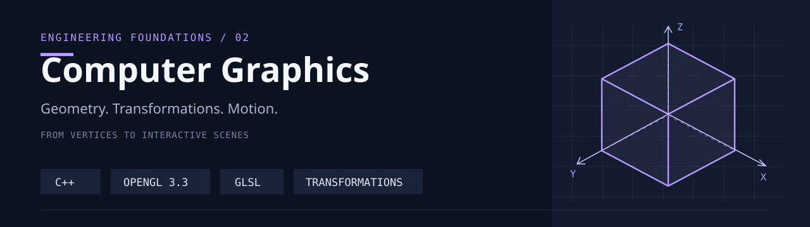

# Computer Graphics

C++와 OpenGL로 좌표 변환, 계층 모델링, 애니메이션, 카메라를 구현하며 학습한 실습 모음입니다.
작은 도형 조작에서 시작해 행성의 공전과 탱크의 부품·카메라 변환으로 확장합니다.

`C++` · `OpenGL 3.3` · `GLSL` · `GLFW` · `GLEW` · `GLM` · `Visual Studio`

[Highlights](#highlights) · [Repository Map](#repository-map) · [Getting Started](#getting-started) · [Study Notes](#study-notes)

## Highlights

| 실습 | 구현 내용 | 소스 · 해설 |
| --- | --- | --- |
| **16 · Pyramid Animation** | 사각뿔 면의 동시·순차 펼치기, 꼭짓점 기준 회전, 육면체 전환 | [C++](1-4/1-4/1-16.cpp) · [해설](CodeStudy/1-16-pyramid-animation-walkthrough.md) |
| **17 · Model Transforms** | 객체별 이동·회전·크기 조절, 자전과 공전, 두 객체의 자리 교체 | [C++](1-4/1-4/1-17.cpp) · [해설](CodeStudy/1-17-model-transforms-walkthrough.md) |
| **18 · Planet & Moon Orbits** | 중심 구, 행성 3개와 달 3개, 궤도 변환, 투영·와이어프레임 전환 | [C++](1-4/1-4/1-18.cpp) · [해설](CodeStudy/1-18-planet-moon-orbits-walkthrough.md) |
| **19 · Tank & Camera** | 육면체 9개의 계층 모델, 부품 애니메이션, 카메라 이동·자전·공전 | [C++](1-4/1-4/1-19.cpp) · [해설](CodeStudy/1-19-tank-camera-walkthrough.md) |

각 실습은 입력으로 상태를 바꾸고, 시간에 따라 상태를 갱신한 뒤 변환 행렬을 만들어 그립니다.
예를 들어 18번에서는 행성과 궤도를 같은 변환으로 계산하고, 19번에서는 부모 부품의 변환을 자식 부품에 전달합니다.

### From Geometry to Motion

| 단계 | 살펴볼 내용 | 시작점 |
| --- | --- | --- |
| 도형 구성 | 육면체·사각뿔의 면과 정점 | [1-13.cpp](1-4/1-4/1-13.cpp) |
| 모델 변환 | 도형의 이동·회전·크기 변경 | [1-14.cpp](1-4/1-4/1-14.cpp) |
| 애니메이션 | 면별 변환과 시간에 따른 움직임 | [1-15.cpp](1-4/1-4/1-15.cpp) |
| 셰이더 | 정점 변환과 구 표면의 간단한 명암 | [18번 vertex](1-4/1-4/1-18-vertex.glsl) · [fragment](1-4/1-4/1-18-fragment.glsl) |

## Repository Map

| 경로 | 역할 |
| --- | --- |
| [`1-1/`](1-1/) | 키 입력과 배경색 변경 |
| [`1-2/`](1-2/) | 화면 분할과 사각형 상태 관리 |
| [`1-3/`](1-3/) | 사각형 생성·선택·드래그 실습 |
| [`1-4/1-4/`](1-4/1-4/) | 도형 조작, 3D 변환, 애니메이션, GLSL 셰이더 |
| [`CodeStudy/`](CodeStudy/) | 10~19번 실습의 한국어 코드 해설 |
| [`default-Gl/`](default-Gl/) | GLFW/GLEW 초기화와 기본 OpenGL 창 |
| [`warning up/`](warning%20up/) | 초기 C++ 준비 실습을 보관한 원래 폴더 |

각 폴더의 Visual Studio 솔루션은 별도 실습 단위입니다. 저장소 전체가 하나의 실행 파일로 빌드되는 구성은 아닙니다.

## Getting Started

### Environment

- Windows와 Visual Studio의 **Desktop development with C++** 워크로드
- 프로젝트에 지정된 **MSVC v145** 도구 집합과 Windows SDK
- OpenGL 3.3 Core Profile을 지원하는 그래픽 환경
- **GLFW**, **GLEW**, **GLM** 헤더와 x64용 링크 라이브러리

현재 추적 파일에는 GLFW/GLEW/GLM 헤더, `.lib`, `.dll`이 포함되어 있지 않습니다.
사용할 라이브러리를 별도로 준비하고 Visual Studio의 포함·라이브러리 디렉터리를 설정해야 합니다.

| 항목 | 현재 소스·설정에서 사용하는 이름 |
| --- | --- |
| 포함 경로 | `GL/glew.h`, `GL/glfw3.h`, `GL/glm/glm.hpp` |
| x64 링크 입력 | `opengl32.lib`, `glew32.lib`, `glfw3.lib` |
| 셰이더 | 선택한 실습의 `1-N-vertex.glsl`, `1-N-fragment.glsl` |

헤더를 놓는 폴더 구조가 위 `#include` 경로와 맞아야 합니다. 동적 라이브러리를 사용한다면 해당 DLL도 실행 환경에서 찾을 수 있어야 합니다.

### Select an Exercise in Visual Studio

1. [`1-4/1-4.slnx`](1-4/1-4.slnx)를 엽니다.
2. **Debug / x64**를 선택합니다. 현재 이 설정에서는 `1-18.cpp`만 빌드 대상으로 활성화되어 있습니다.
3. 다른 실습은 파일 속성의 **Excluded From Build**를 조정해 원하는 `.cpp` 하나만 활성화합니다.
4. 디버깅 작업 디렉터리를 `1-4/1-4`로 설정해 해당 GLSL 파일을 찾도록 합니다.
5. 빌드 후 실행하고, 자세한 키 조작은 해당 [CodeStudy 문서](#study-notes)를 참고합니다.

여러 실습의 `main()`을 동시에 링크하지 않도록 구성별 선택을 확인합니다. 현재 Release 설정에는 여러 실습 소스가 활성화되어 있습니다.

### PowerShell Helper

[`run-exercise.ps1`](1-4/1-4/run-exercise.ps1)의 인터페이스는 다음과 같습니다.

```powershell
cd .\1-4\1-4
.\run-exercise.ps1 -Number 18
.\run-exercise.ps1 -Number 19 -Configuration Debug -BuildOnly
```

| 매개변수 | 허용 값 · 기본값 |
| --- | --- |
| `-Number` | `16`, `17`, `18`, `19` · 기본 `18` |
| `-Configuration` | `Debug`, `Release` · 기본 `Debug` |
| `-BuildOnly` | 실행 없이 빌드만 요청하는 스위치 |

**현재 연결 상태:** 스크립트는 `/p:Exercise`를 전달하지만, 프로젝트에는 이를 이용한 소스 선택과 과제별 출력 경로 정의가 없습니다.
따라서 위 명령만으로 번호별 빌드·실행이 완성되어 있지는 않습니다. 현재 사용 시에는 Visual Studio에서 소스를 직접 선택하고 실제 빌드 출력을 확인해야 합니다.
기존 CodeStudy 문서의 자동 선택 설명은 이 프로젝트 설정과 차이가 있습니다.

## Study Notes

코드의 상태 변수, 입력 처리, 변환 순서, 그리기 흐름을 한국어로 정리했습니다.

| 구간 | 해설 |
| --- | --- |
| 2D 도형 조작 | [10 · Shape Matching](CodeStudy/1-10-shape-matching-walkthrough.md) · [11 · Movement & Collision](CodeStudy/1-11-board-movement-collision-walkthrough.md) · [12 · Shape Movement](CodeStudy/1-12-shape-movement-matching-walkthrough.md) |
| 3D 구성과 변환 | [13 · Faces](CodeStudy/1-13-cube-pyramid-faces-walkthrough.md) · [14 · Transforms](CodeStudy/1-14-cube-pyramid-transforms-walkthrough.md) · [15 · Animation](CodeStudy/1-15-cube-pyramid-animation-walkthrough.md) |
| 객체와 장면 | [16 · Pyramid](CodeStudy/1-16-pyramid-animation-walkthrough.md) · [17 · Models](CodeStudy/1-17-model-transforms-walkthrough.md) · [18 · Orbits](CodeStudy/1-18-planet-moon-orbits-walkthrough.md) · [19 · Camera](CodeStudy/1-19-tank-camera-walkthrough.md) |

[`tests/`](1-4/1-4/tests/)에는 일부 실습의 검사 프로그램과 실행 스크립트가 있습니다. 검사 역시 로컬 C++·OpenGL 환경이 필요합니다.

## Related Repositories

- [Data Structure](https://github.com/sanu1227/Data-Structure) — 자료구조와 알고리즘 구현 실습
- [WinAPI](https://github.com/sanu1227/WinAPI) — Windows 이벤트 처리와 데스크톱 프로그램 실습

학습 과정의 코드와 설명을 함께 보관하는 저장소입니다. 라이브러리 설치 상태와 실습별 프로젝트 설정에 따라 추가 환경 구성이 필요할 수 있습니다.
